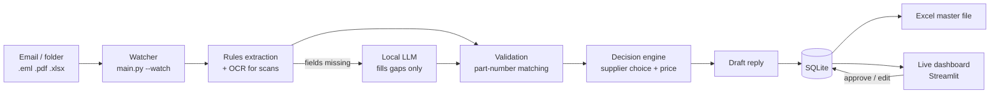

# RFQ Automation: from customer email to a priced, reviewed quote

Reads incoming Requests for Quotation (RFQs) from **email text, PDF (also scanned), and Excel forms**,
stores them in a database and an Excel master file, **picks the best supplier option per line**,
drafts the reply, and shows everything in a **live dashboard** where a person only reviews exceptions.

Everything is free: Python, SQLite, Streamlit, Tesseract OCR and an optional local LLM (Ollama).
All company, supplier, part and price data in this repo is **fictional**.

## Architecture

Design rule: the **LLM only reads and writes text**. Prices, supplier choice and margins come from plain,
explainable code, and everything the LLM filled in is flagged for a human to verify.

## Quick start
```bash
python -m venv .venv && source .venv/bin/activate       # Windows: .venv\Scripts\activate
pip install -r requirements.txt
python make_reference_data.py        # fictional part master, supplier prices, margin rules -> data/
python make_testset.py --n 12 --out inbox      # fictional RFQs in 6 formats
python main.py                       # process the inbox once
streamlit run app.py                 # dashboard (second terminal)
python main.py --watch               # live mode: re-checks the inbox every 30 s
python tests/test_core.py            # automated tests
```
In live mode, copy new RFQ files into `inbox/` and watch them appear in the dashboard within seconds.

## Optional: local LLM for messy RFQs (free)
1. Install [Ollama](https://ollama.com), then `ollama pull qwen2.5:7b` (any instruction model works; set `OLLAMA_MODEL`).
2. `python main.py --watch --llm`
3. Free-text emails with no labels ("could you quote 500 x BKR6E-11 by end of month?") are now read by the model.
   They always land as **Needs review** because an LLM filled them in.
Measure it: `python evaluate.py` (rules only) vs `python evaluate.py --llm`.

## Optional: OCR for scanned PDFs
Install Tesseract and Poppler on your OS (add the German language pack for German scans). Scanned PDFs are then read automatically.

## Optional: real mailbox
Set `RFQ_IMAP_USER` and `RFQ_IMAP_PASSWORD` (Gmail app password), then `python main.py --watch --fetch-email`.
Company Outlook/365 accounts usually need the Microsoft Graph API instead.

## What each part does
| File | Job |
|---|---|
| `main.py` | Command line + watch loop |
| `rfq_pipeline/extractor.py` | Rules: labels, tables and lines from text, PDF, Excel (English + German) |
| `rfq_pipeline/ocr.py` | Tesseract for scanned PDFs |
| `rfq_pipeline/llm_fallback.py` | Ollama: fills only missing fields, strict JSON, never guesses |
| `rfq_pipeline/validation.py` | Fuzzy part-number matching, quantity sanity checks |
| `rfq_pipeline/decision.py` | Feasibility by delivery date, supplier scoring, margin-based pricing, one-sentence reason |
| `rfq_pipeline/drafting.py` | Quote email; LLM polish is rejected if it changes any number |
| `rfq_pipeline/db.py` | SQLite (RFQs, lines, supplier options, events, human corrections) |
| `rfq_pipeline/export.py` | Rebuilds `output/RFQ_Master.xlsx` with live formulas |
| `rfq_pipeline/scoring.py` | Priority score for the dashboard queue |
| `app.py` | Live dashboard: queue, details, approve/reject, metrics, event log |
| `make_testset.py`, `evaluate.py` | Synthetic test RFQs with ground truth and accuracy scoring |

## How decisions are made
For each requested part: list suppliers -> drop those that cannot deliver by the requested date
(lead time + 3 days transit) -> score the rest `0.5 x cost + 0.3 x lead time + 0.2 x reliability`
-> price from the category margin (customer target price is respected if it stays above the 10% minimum margin)
-> write a one-sentence reason. Weights and margins are in `config.py` and `data/*.csv`.

## Results on the synthetic test set (30 RFQs, `python evaluate.py`)
| Format | Rules only |
|---|---|
| email (EN), email (DE, European numbers), PDF, Excel, email + PDF | 100% of fields correct |
| free-text email (no labels) | requester/deadline/lines 0% (needs the LLM) |

**Caution:** the structured formats are my own templates, so 100% is optimistic. Real RFQs will be messier.
Run `--llm` on your machine and add your own difficult examples to measure the true gain.

## Limitations and next steps
- Prices are all in EUR; no FX conversion. Reference data is fictional - plug in real CSVs with the same columns.
- Fuzzy matching and OCR can be wrong, which is why RFQs with LLM-filled or unmatched data are flagged.
- Next: real customer/supplier master data, FX rates, stock levels, a Graph API intake for Outlook, authentication on the dashboard,
  a feedback-driven tuning loop using the `feedback` table, and a Docker image.
